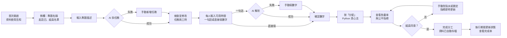

# 開發規格：公平分工引擎（FairSplit）

| 項目 | 內容 |
|---|---|
| 課程 | 程式設計-Python（國立中央大學，黃鈺晴老師） |
| 組別 | 4 人：A 林其棣、B 董謙耀、C 鄭勤翰、D 黃政捷 |
| 版本 | v1.1（2026-11-23） |
| 主題依據 | Microsoft × NCU AI Innovation Demo Day 競賽辦法（主題：AI for Better Campus & Life）；本專題為課堂期末專題，不參賽 |
| 一句話目標 | 讓大學小組看到「誰的負擔超過他的可用時間」，並取得分工建議 |

**摘要**

- **問題**：小組分工靠感覺，工時估不準、每人可用時間不同，常到截止前才發現有人負擔過重。
- **做法**：AI 把專題描述拆成任務並估工時，把「週三晚上有空」這類句子轉成可用時間；Python 依負載率（分配工時 ÷ 可用工時）用貪心法分配，負載率差距 0.1 以內時優先採用組員偏好，並計算公平指標與完成率；最後由組員決定是否採用。
- **MVP 三項**：任務拆解與編輯、可用時間與自動分配、公平指標與進度（第 3 節）。

---

## 1. 問題與需求

### 1.1 問題陳述

大學小組報告與專題的組員（社團、系學會等校園團隊也一樣），在分配任務時因為工時估不準、每人可用時間不同、進度不透明，常到截止前才發現負擔不均或進度落後。

本組 4 位組員在過去的小組作業中都遇過上述三種狀況。

**實例**：某組的小報告每人分到數量相近的主題，但有的主題要蒐集資料、查證與計算，有的只要整理基本概念，實際工作量差很多。只看主題數無法判斷是否公平，因此本工具以工時而非任務數衡量負載（1.4、4.1）。

### 1.2 目標使用者

| 項目 | 設定 |
|---|---|
| 主要使用者 | 大學課堂的報告與專題小組，由一人在分工會議時操作 |
| 使用時機 | 分工會議當下；進度落後時再開一次 |
| 主要設計與測試情境 | 3–5 人、10–20 個任務、專題期間 2–8 週；人數與任務數沒有程式上限 |
| 延伸情境 | 社團活動、系學會等需要分工的校園團隊 |

### 1.3 訪談規劃

**對象與方式**：11/29 前每位組員訪談 2 位非本組同學，共 8 位，每人約 3 分鐘，傳訊息或當面皆可，只記原話。
**告知與去識別化**：訪談開始前先說明「回答會去掉姓名後用在課堂專題與簡報」，對方同意才記錄。紀錄存 `docs/interviews.md`，只寫「受訪者 1／系級」，給 AI 前刪除姓名、學號與聯絡方式。

| # | 問題 | 要驗證的假設 |
|---|---|---|
| Q1 | 你上次做小組報告時，任務怎麼分的？事後有沒有覺得誰特別重或特別輕？是怎麼發現的？ | 負擔不均是常見問題，且多半很晚才發現 |
| Q2 | 如果分工前要填「每週有空幾小時」，你願意嗎？什麼情況下你會不想填？ | 可用工時這個輸入是否可行 |
| Q3 | 如果畫面顯示「你的負載率比其他人高」，你覺得有用還是有壓力？希望怎麼呈現？ | 公平指標會不會被當成監控 |
| Q4 | 你有沒有直接請 ChatGPT 或 Copilot 幫忙分工過？結果有用嗎？ | 聊天機器人能不能取代本工具 |

### 1.4 設計決定與待驗證問題

MVP 先照下表定案，訪談後再調整。

| 問題 | MVP 的決定 | 之後怎麼驗證 |
|---|---|---|
| 「公平」怎麼定義 | 負載以工時計算，不以任務數計算（1.1 實例）；負載率越接近彼此越公平（4.1）；難度由工時反映；偏好在差距 0.1 以內時採用（4.3） | Q3 回饋 |
| 可用工時怎麼取得 | 只收「每週可用小時」與「不可用日期」，不收原因或備註；可用一句話描述（AI 轉成數字，原句不存檔），或直接填 | Q2 回饋是否嫌麻煩 |
| 被當成監控 | 只呈現負載率與工時，不做排名、排序，也不加「最忙」「最閒」等標籤（4.4） | Q3 回饋 |

---

## 2. 解決方案總覽

### 2.1 使用流程



### 2.2 與現有做法比較

| 做法 | 記錄誰做什麼 | 估工時 | 考慮每人可用時間 | 公平指標 | 同樣輸入得到同樣結果 | 可鎖定部分任務再重分 |
|---|---|---|---|---|---|---|
| 共用文件／LINE 記事本 | ✓ | ✗ | ✗ | ✗ | — | ✗ |
| Trello／Notion 看板 | ✓ | 手動 | ✗ | ✗ | — | ✗ |
| 直接問 ChatGPT／Copilot | 對話內 | ✓ | 要自己描述 | 由模型生成，沒有程式驗證 | ✗ 每次答案可能不同 | 要重貼全部資料再問 |
| 公平分工引擎 | ✓ | AI 估計＋可修改 | ✓ | Python 計算，可手算 | ✓ | ✓ |

### 2.3 優勢與缺陷

| 優勢 | 缺陷 |
|---|---|
| 指標由程式算，同樣資料永遠得到同樣結果，可手算驗證 | 工時仍是估計，AI 估完要人修正；MVP 不回填實際工時 |
| 同時考慮任務工時、每人可用時間與偏好 | 每位組員都要提供可用時間，沒人填就算不出來 |
| 不排名，只看負載是否均衡與完成率 | 可用時間只能設每週固定時數，忙閒變化只能用不可用日期處理 |
| AI 失敗時手動輸入仍可完成全部流程 | 單機、單人操作，沒有多人同步 |
| 可鎖定已談好的任務、拆分多人合作的任務 | 比直接問聊天機器人多幾個輸入步驟 |

---

## 3. MVP 功能表

| # | 功能 | 使用者做什麼 | 程式要做什麼 | 完成標準 |
|---|---|---|---|---|
| 1 | 任務拆解與編輯 | 輸入專題描述（截止日與人數取自側欄），按「AI 拆任務」；逐項修改名稱、工時與偏好負責人，手動新增、刪除，或把多人合作的任務拆成兩份 | 帶入專題背景呼叫 AI（5.3）→ 逐項驗證 → 顯示可編輯表格 → 寫入 `tasks`；AI 失敗時顯示提示，改在表格手動新增 | 驗收案例 5、6、8、15、19 通過 |
| 2 | 可用時間與自動分配 | 每人填每週可用小時與不可用日期，不填原因或備註（也可用一句話描述，按「AI 解析」後確認數字）；按「分配」；可再手動改任務負責人並勾選「鎖定」 | AI 解析可用時間（5.3）→ 驗證，只保留數字與日期，原句不存檔 → 計算每人可用工時 → 以貪心法分配未鎖定的任務（4.3）→ 寫回 `assignee` | 驗收案例 1–4、7、9、10、11、18、20、21 通過 |
| 3 | 公平指標與進度 | 查看負載率長條圖、每人的負載率算式、最大最小比、超載提示與完成率；專題進行中在任務表更新狀態 | 計算 4.4 的指標與 4.5 的完成率 → 依 3.1 呈現 | 驗收案例 1–4、17、22 的數字與手算一致 |

**跨功能需求：資料使用告知**。第一次開啟時說明資料怎麼存、哪些內容會送給 AI，以及可用時間只用於計算工時、不顯示原因、不做個人排名（5.6）。驗收案例 12。

**跨功能需求：自動存檔**。每次修改後自動寫回 `data/`，重新整理頁面不會遺失資料（見 15.2）。驗收案例 13。

### 3.1 畫面配置

用 `st.sidebar` 加三個 `st.tabs` 分頁，依操作順序由左到右。

| 區域 | 元件 | 內容 | 負責 |
|---|---|---|---|
| 側欄 | `text_input`、`date_input`、按鈕 | 專題名稱、起始日（預設為今天）、截止日；組員名單（新增、刪除，姓名不可空白也不可重複；刪除組員時，其負責的任務改為未指派、取消鎖定，以他為偏好負責人的任務清除偏好）；「載入 Demo 資料」按鈕（用 `data/demo/` 的專題、組員、任務覆蓋目前資料，不改 `settings`，按下後先跳確認）；「資料使用說明」按鈕 | A |
| 分頁 1「任務」 | `text_area`、`text_input`、按鈕、`data_editor` | 專題描述；專題類型與組員程度（選填，例如「程式專題」「初學者」）；「AI 拆任務」按鈕（已有任務時先跳確認，結果取代未鎖定且未完成的任務，鎖定或已完成的任務保留，見 `merge_ai_tasks`）；任務表（名稱、工時、來源、偏好負責人；`num_rows="dynamic"` 可直接增刪列）；「拆成兩份」按鈕（4.6） | D |
| 分頁 2「可用時間」 | 每位組員一列：`text_input`、按鈕、`number_input`、`multiselect` | 一句話描述（提示「不用寫原因」；只送 AI 解析，不存檔）；「AI 解析」按鈕；每週可用小時；不可用日期（選項為專題期間內的每一天）；可用工時；「確認」按鈕。不設原因或備註欄位 | A |
| 分頁 3 上半「分配」 | 按鈕、`data_editor` | 「分配」按鈕（再按一次依 4.3 重分）；任務表（負責人、鎖定、狀態） | A |
| 分頁 3 下半「公平指標」 | `bar_chart`、`metric`、`warning`、`expander` | 負載率長條圖（橫軸為組員姓名，依組員名單順序，不依負載率排序）；每位組員的負載率旁以文字顯示算式（4.4，`format_load_formula`）；最大最小比；全組完成率；超載與「未參與分配」提示；「詳細數據」收合區塊（標準差、Gini、每人可用工時、分配工時與完成率） ||| C |

AI 按鈕在 `ai_enabled` 為 `false` 時停用（`disabled=True`）。

分頁 3 只呈現負載率與工時，不顯示排名、名次，也不加「最忙」「最閒」等標籤。

---

## 4. 公平定義與分配規則

### 4.1 名詞

| 符號 | 名稱 | 定義 |
|---|---|---|
| C_i | 可用工時 | 組員 i 在專題期間可投入的總小時，算法見 4.2 |
| W_i | 分配工時 | 指派給組員 i 的所有任務 `est_hours` 總和；未指派的任務不計入任何人 |
| L_i | 負載率 | W_i ÷ C_i；C_i = 0 的組員不計算；C_i > 0 但沒分到任務的組員 L_i = 0 |
| n | 參與人數 | C_i > 0 的組員人數 |

任務難度不另設欄位，由估計工時反映。

C_i = 0 的組員即使有鎖定或已完成的任務，也不計入負載率與公平指標，畫面標「未參與分配」。

### 4.2 可用工時計算

```text
可用天數 = 起始日到截止日（兩端都算）的天數 − 落在期間內的不可用日期數
C_i     = 每週可用小時 ÷ 7 × 可用天數
```

- 起始日：MVP 用 `project.json` 的 `start`（側欄預設為今天，避免把已過去的天數算進可用工時）；第二版重排時改用「今天」。
- 不可用日期若重複或落在期間外，不扣除。
- 顯示時四捨五入到小數 1 位，計算時保留原值。
- 範例：`start` 2026-11-23、`deadline` 2026-12-18 共 26 天；組員每週 8 小時、1 個不可用日 → 8 ÷ 7 × 25 ≈ 28.6 小時。

### 4.3 分配規則（貪心法）

1. 排除 C_i = 0 的組員；若沒有任何人可分配，顯示「請先輸入可用時間」並停止（`assign_tasks` 回傳空 dict，畫面不改動任何指派）。
2. `locked` 為 `true` 或 `status` 為 `"done"` 的任務維持原負責人，先計入該組員的 W_i，不參與後續分配；沒有負責人的已完成任務不計入任何人。
3. 其餘任務依 `est_hours` 由大到小排序；工時相同時依 `id` 的數字部分由小到大排序（T2 排在 T10 前面，結果才會固定）。
4. 依序處理每個任務：對每位組員計算「接下這個任務後的新負載率」，找出新負載率最低的人。並列時依序比較：可用工時較大者優先 → 組員 `id` 的數字部分較小者優先。
5. 若任務有偏好負責人（`preferred`），且他的新負載率不超過第 4 步最低值加 0.1，改分給偏好負責人；否則分給第 4 步找到的人。0.1 定義為 `logic/planner.py` 的常數 `PREFERENCE_TOLERANCE`。

`assign_tasks` 回傳 dict（任務 id → 組員 id），只含有負責人的任務；沒有負責人的已完成任務不在 dict 內，維持未指派。`ui/assign.py` 只把結果寫回未鎖定且未完成的任務。

**為什麼用貪心法**：先放大任務、再用小任務補空隙，每一步都能手算。

### 4.4 公平指標

| 指標 | 公式 | 解讀 | 邊界情況 |
|---|---|---|---|
| 最大最小比 | max(L) ÷ min(L) | 1.0 代表完全一樣；越大越不均 | min(L) = 0 時顯示「—」，函式回傳 `None` |
| 標準差 | 母體標準差 √(Σ(L_i − 平均)² ÷ n) | 0 代表完全一樣 | n = 1 時為 0 |
| Gini 係數 | Σ_i Σ_j \|L_i − L_j\| ÷ (2 × n² × 平均) | 0 代表完全均衡，最大接近 1 | 平均為 0 時回傳 0 |
| 超載 | L_i > 1 | 分到的工時超過他的可用時間 | 標「超過可用時間」，不自動處理 |

**畫面呈現原則**：
- 只呈現負載率與工時，不做排名、排序，也不加「最忙」「最閒」等標籤。
- 長條圖依組員名單順序排列，不依負載率排序。
- 整體指標旁附一句白話說明，例如「最大最小比 1.17：組內最高與最低負載率相差 17%」。
- 每位組員的負載率旁以文字顯示算式，字串由 `format_load_formula` 產生：
  - 格式：`負載率 = 已分配工時 ÷ 可用工時 = W ÷ C = L`。
  - W、C 四捨五入到小數 1 位，整數不顯示小數點；L 用 W、C 原值相除後四捨五入到小數 2 位。
  - 例：W = 12、C = 15 →「負載率 = 已分配工時 ÷ 可用工時 = 12 ÷ 15 = 0.80」。
  - C = 0 時不顯示算式，改顯示「無可用工時」。

### 4.5 完成率

- 每人完成率 = 該組員 `status` 為 `"done"` 的任務工時 ÷ 該組員的 W_i；W_i = 0 時顯示「—」。
- 全組完成率 = 所有已完成任務工時 ÷ 所有已指派任務工時；沒有已指派任務時顯示「—」。
- 完成率只顯示，不影響分配。

### 4.6 拆分任務

- 工時 ≥ 1 的任務才可拆分。
- 原任務：工時改為原工時 ÷ 2 無條件進位到 0.5 的倍數，名稱加「（1）」，保留負責人、鎖定與偏好。
- 新任務：工時為原工時減去原任務的新工時，名稱加「（2）」，id 用 `next_task_id`，未指派、未鎖定。

---

## 5. AI 的角色與邊界

### 5.1 分工

| 環節 | AI 做什麼 | Python 做什麼 | 人做什麼 | 版本 |
|---|---|---|---|---|
| 任務拆解與工時估計 | 依專題描述、截止日、人數，以及選填的專題類型與組員程度，拆成 5–15 個任務並估工時 | 解析 JSON、逐項驗證、標示「AI 估計」 | 修改、刪除、補充任務 | MVP |
| 解析可用時間 | 把「週三週五晚上各 3 小時，12/1 要考試」轉成每週小時與不可用日期 | 驗證範圍與日期、換算可用工時 | 按「確認」才寫入 | MVP |
| 解釋重排原因 | 用白話說明為什麼建議調整 | 計算重排結果與前後指標，AI 只能引用這些數字 | 決定是否採用 | 第二版 |

### 5.2 邊界與防護

- AI **不決定**誰做哪個任務，也**不計算**任何指標；所有數字由 Python 算出並可手算驗證。
- AI 只能回傳 JSON；程式用 `try/except` 解析，格式錯誤、逾時、超過額度或沒有金鑰時一律退回手動輸入。
- AI 的輸出都經使用者檢查：任務可直接編輯，改過工時後 `est_source` 變成 `"manual"`；可用時間按「確認」才寫入。
- 送給 AI 的內容只有：專題描述、截止日、組員人數、專題類型與組員程度（選填，有填才送）、可用時間描述句。所有送出的文字由 `call_ai` 先經 `mask_names` 把全部組員姓名換成「組員」，姓名不會送出。
- API 金鑰放 `.env`，`.env` 列入 `.gitignore`，不寫進程式、不上傳、不貼給別人。

### 5.3 提示詞（MVP）

**任務拆解**（`build_task_prompt`）

```text
你是大學課堂專題的專案助理。以下是一個 {member_count} 人小組的專題，
距離截止日 {deadline} 還有 {weeks} 週。
專題類型：{project_type}
組員程度：{member_level}
請把專題拆成 5 到 15 個任務，並估計每個任務需要的工作小時
（0.5 到 20 之間，以 0.5 為單位），估計時考慮專題類型與組員程度。

只回傳 JSON，不要任何說明文字，格式如下：
{"tasks": [{"title": "任務名稱，30 字以內", "est_hours": 3}]}

專題描述：
{description}
```

提示詞含 JSON 範例的大括號，組字時用 `str.replace`，或把 `{`、`}` 寫成 `{{`、`}}`，避免 `str.format` 出錯。

`weeks` =（截止日 − 今天）的天數 ÷ 7，無條件進位，最少為 1，由 `ui/tasks` 計算後傳入。`project_type` 或 `member_level` 為空字串時，整行「專題類型：」或「組員程度：」不放進提示詞。

**可用時間解析**（`build_availability_prompt`）

```text
專題期間是 {start} 到 {deadline}。請把下面這句話轉成可用時間：
每週可投入的總小時數，以及期間內完全不能工作的日期。
句子沒提到的部分不要自行假設；無法判斷每週小時數時填 null。

只回傳 JSON，不要任何說明文字，格式如下：
{"weekly_hours": 6, "unavailable_dates": ["2026-12-01"]}

句子：{text}
```

### 5.4 AI 回應驗證規則

解析前先去掉回應前後的空白與 Markdown 程式碼區塊標記（` ```json `、` ``` `），再用 `json.loads` 解析。

**任務**（`validate_task`）

| 欄位 | 規則 | 不合法時 |
|---|---|---|
| `title` | 字串，去除空白後 1–30 字 | 該任務丟棄並在畫面提示 |
| `est_hours` | 數字，0.5 ≤ 值 ≤ 20 | 該任務丟棄並在畫面提示 |
| 整體 | 頂層為 dict 且含 `tasks` list；合法任務數 ≥ 1 | 回傳空 list，切換手動輸入 |

`split_tasks_with_ai` 只回傳驗證通過、含 `title` 與 `est_hours` 的任務；之後由 `merge_ai_tasks`（`logic/task_ops.py`，B；不 import `ai/`）補上 `id`（用 `next_task_id`：現有任務 id 數字部分的最大值加 1，依序遞增）、`est_source: "ai"`、`assignee: null`、`locked: false`、`preferred: null`、`status: "todo"` 等欄位。

**可用時間**（`validate_availability`）

| 欄位 | 規則 | 不合法時 |
|---|---|---|
| `weekly_hours` | 數字，0 ≤ 值 ≤ 60 | 欄位留空，請使用者手填 |
| `unavailable_dates` | list，每項為 `YYYY-MM-DD` 且落在專題期間內 | 不合法的日期丟棄並提示 |

### 5.5 AI 供應商

使用 Google AI Studio 的 Gemini API 免費額度，以 `openai` 套件呼叫；`call_ai` 從 `.env` 讀取三個值，不寫死在程式裡。

| 服務 | `AI_BASE_URL` | `AI_MODEL` | `AI_API_KEY` | 注意 |
|---|---|---|---|---|
| Google AI Studio（Gemini API 免費額度） | `https://generativelanguage.googleapis.com/v1beta/openai/` | D 實測時使用的 Flash 系列模型 | AI Studio 產生的 API 金鑰 | 條款要求使用者年滿 18 歲；免費額度送出的內容，Google 會用於改進其產品 |

- **選定方式**：原本的另一個候選 GitHub Models 已於 2026/7/30 停止服務，因此直接選定 Gemini。D 於 11/27 實測：準備 3 段專題描述與 5 句可用時間描述，先由組員寫出正確答案，再檢查：
  1. 回傳的 JSON 能通過 5.4 驗證的比例；
  2. 可用時間解析與正確答案相符的句數（用 5.3 的可用時間提示詞測試）；
  3. 拆出的任務與工時是否合理（4 人各自評分 1–5）；
  4. 回應時間，超過 15 秒視為失敗。
  結果：可用時間 5 句中 4 句符合，1 句逾時；3 段任務描述都產生合法任務，合理度平均 4.5／5。詳細數字見 `docs/ai-log/D.md`。
- **呼叫參數**：要求 JSON 格式回應（`response_format={"type": "json_object"}`），5.4 的去除程式碼區塊處理保留作備案；`reasoning_effort` 設為最低。兩項都在實測時確認可用。
- **備案**：Gemini 無法使用時，AI 按鈕預設停用，MVP 全部以手動輸入完成；之後若有其他支援 OpenAI 相容格式的服務，只需改 `.env`。
- **開發用的 AI 程式助手**：每人自選，例如 GitHub Copilot（GitHub Education 學生方案）、Claude 或自己訂閱的其他 AI；使用紀錄一律記入自己的 `docs/ai-log/代號.md`（10.2）。作品內的 AI 一律用上表的服務，不使用個人訂閱。

### 5.6 資料使用告知（彈窗內容）

第一次開啟時以 `st.dialog(dismissible=False)` 顯示，沒有關閉鈕，使用者選擇後才進入主畫面；選擇結果存在 `data/settings.json`，之後不再跳出；側欄「資料使用說明」按鈕可再次打開彈窗並重新選擇，新選擇覆寫 `settings`。

```text
FairSplit 會記錄哪些資料
・專題描述、任務、組員名稱與可用時間，每次修改後自動存在這台電腦的 data/ 資料夾，不會上傳。
・使用 AI 功能時，會把專題描述、截止日、組員人數、專題類型與組員程度（有填才送）
  與可用時間描述句送到 Google Gemini API（5.5）；組員姓名不會送出。
・Google 可能使用送出的內容改進其產品，請勿輸入個人資料。
・可用時間只用於計算工時，不顯示原因，也不做個人排名。
・刪除 data/ 資料夾即可清除全部資料。

[同意並開始]   [不使用 AI，只用手動輸入]
```

---

## 6. 第二版功能

依優先順序：

1. **落後判定與重排建議**：7 天沒更新狀態的任務標「待確認」；剩餘任務工時 ÷ 剩餘可用工時 > 1 時判定落後。系統以今天為起點重算可用工時，只重排未完成任務，並排顯示重排前後的負載率與指標。結果是建議，按「採用」才寫入。
2. **任務依賴**：`depends_on` 與拓撲排序；偵測循環依賴並顯示是哪幾個任務。
3. **實際工時校正**：統計每位組員「實際 ÷ 估計」平均，下次估計時提示偏差（例：「過去平均多花 30%」）。
4. **AI 解釋重排原因**。

---

## 7. Demo 與成果驗證

### 7.1 3 分鐘 Demo 腳本

使用 `data/demo/` 的固定資料：4 人中 3 人的可用時間已預先填好。

| 時間 | 畫面 | 講什麼 |
|---|---|---|
| 0:00–0:30 | 標題頁 | 問題：分工靠感覺，截止前才發現負擔不均；引用 1–2 句訪談原話與訪談人數 |
| 0:30–2:00 | 操作畫面 | 按「AI 拆任務」→ 改一個工時 → 第 4 人輸入一句話，AI 轉成可用時間 → 按「分配」→ 看長條圖與指標 → 把一個任務改給別人並鎖定，指標即時變化 → 把一個任務標為已完成，完成率更新 |
| 2:00–2:30 | 試用結果 | 一組試用小組原本分工的負載率（標出超載者）與工具建議並排，以及 7.2 的判準結果 |
| 2:30–3:00 | 收尾 | 和直接問 ChatGPT 差在哪：數字由程式算、可重現、可鎖定；第二版做進度重排 |

備案：AI 現場失敗時改示範手動輸入；另錄一支完整 Demo 影片。

### 7.2 影響力判準

判準在試用前訂定；試用後由 C 把結果寫入 `docs/trials.md` 並 commit，未達成也照填。

| 指標 | 怎麼測 | 判準 |
|---|---|---|
| 超載偵測 | 找 2–3 組進行中的小組，輸入他們的任務、估計工時、每人可用時間與目前分工，看工具標出哪些組員超載（L > 1） | 被標出超載的組員中，過半本人確認負擔確實過重 |
| 行動改變 | 看完工具建議後問：「你們會依建議調整分工嗎？」（會／部分會／不會） | 過半小組選「會」或「部分會」 |
| 分工會議時間 | 試用者自評：用工具前後，分工討論花幾分鐘 | 只記錄，不設判準 |
| 本組自用 | 用本工具分配本專題的任務，第 4 週回顧每人實際負擔 | 只記錄，作為實際使用案例 |

---

## 8. 對應評分

### 8.1 課程分組專題評分

分組專題占學期成績 30%，內部比例如下。

| 項目 | 比例 | 本專題怎麼準備 | 對應章節 |
|---|---|---|---|
| 提案簡報 | 20% | 依辦法的四段架構製作 PowerPoint（見 8.2） | 1、2、7 |
| 專題成果報告（含 Demo） | 80% | 以下五項 | |
| └ 程式功能完整性與創新度 | 40% | MVP 三項、驗收案例全通過、中文註解、README | 3、4、15.3、16、17 |
| └ AI 協作歷程 | 15% | 每人在 `docs/ai-log/代號.md` 每次用 AI 記一筆，寫出自己的判斷 | 5、10 |
| └ GitHub 協作歷程 | 15% | 每人一個分支、PR 合併、commit 訊息有意義 | 9.3 |
| └ 組內互評 | 10% | 每人負責固定的檔案與函式（16.2），貢獻在 commit 紀錄中看得見 | 16 |
| └ 期末發表 | 20% | 每人能解釋自己的函式；用 AI 以初學者角度出題自我檢查 | 7.1 |

### 8.2 提案簡報評分（課程沿用競賽五項標準，各 20%）

簡報採辦法建議的四段架構：封面 → 問題與需求 → AI 應用解決方案 → 預期成果與影響。

| 標準 | 本專題的對應 | 簡報頁 |
|---|---|---|
| 問題與需求 | 1.1 問題陳述、訪談人數與原話 | 2 |
| AI 創新應用 | AI 拆任務與解析可用時間、Python 算公平、人做決定（5.1） | 3–4 |
| 解決方案 | 2.1 流程圖、MVP 三項、貪心法、實際畫面；2.2 與現有做法比較、2.3 優勢與缺陷 | 5–7 |
| 影響力 | 7.2 判準與試用結果、本組自用案例 | 8 |
| 成果表達 | 7.1 Demo 腳本 | 全部 |

---

## 9. 時程與協作

### 9.1 時程

| 週次 | 日期 | 目標 | 檢查點 |
|---|---|---|---|
| 0 | 11/20–11/22 | 繳交 spec.md；A 建立 GitHub repo；A 產生所有函式的空殼與 `app.py` 框架，B 放好 `data/demo/` 範例資料（15.4） | `streamlit run app.py` 能開出完整畫面 |
| 1 | 11/23–11/29 | 每人把邏輯函式的空殼換成真正的程式；決定 AI 供應商（11/27 選定 Gemini）；每人訪談 2 位 | 案例 1–4、6、7、9、16–22 通過；ai-log 每人 ≥ 1 筆 |
| 2 | 11/30–12/06 | 每人完成自己負責的畫面；接上兩個 AI 功能；README 初稿（15.3） | 全部案例通過；組員照 README 能跑起來 |
| 3 | 12/07–12/13 | 找 2–3 組同學試用並把 7.2 結果寫入 `docs/trials.md`（C）；第二版重排：B 寫 `reassign_unfinished`；A 寫 `ui/reassign.py`；C 寫 `estimate_bias`；D 寫 `explain_reassign_with_ai` | 試用紀錄；ai-log 每人 ≥ 2 筆 |
| 4 | 12/14–12/20 | 修正試用回饋；每人完成自己負責的簡報頁（16.2）；A 錄 Demo 影片；發表練習 | 每人能 1 分鐘講完自己的函式 |

### 9.2 進度落後時的取捨

未達成時照表處理。

| 檢查點 | 未達成時的處理 |
|---|---|
| 11/29：案例 1–4、6、7、9、16–22 未全部通過 | A、D 暫停畫面工作，先支援 B、C 完成分配與指標 |
| 12/06：案例 10、11（AI 解析可用時間）未通過 | A 移除「AI 解析」按鈕，分頁 2 只留手動填寫；D 改支援 A 的整合與 README |
| 12/06：案例 5、8（AI 拆任務）未通過 | 現場 Demo 改用手動輸入，AI 拆任務以錄影呈現 |
| 12/13：第二版重排未完成 | 停止第二版，剩餘時間用於試用、簡報與 Demo 影片 |

### 9.3 GitHub 協作規範

- `main` 分支只放能執行的版本；每人在 `feat-<組員代號>-<功能>` 分支開發，例如 `feat-B-assign`。
- 每完成一個函式就發 Pull Request，至少一位其他組員看過再合併。
- commit 訊息用中文寫「做了什麼」，例如「新增 gini 函式與案例 1、2 測試」。
- 程式以外的成果（訪談彙整、試用紀錄、AI 實測、AI 協作紀錄）也寫進 `docs/` 並由負責人自己 commit，讓每人的貢獻都在 commit 紀錄中看得見。
- 只修改自己負責的檔案；要改別人的檔案，先請負責人改。
- 合併前在本機執行 `python run_tests.py`，全部通過才發 PR。

### 9.4 完成定義（每個函式）

1. 名稱、參數、回傳和所在檔案與第 16 節一致。
2. 有中文註解。
3. 對應的驗收案例通過。
4. 負責人能不看程式說出每一行在做什麼。
5. 用過 AI 的話，自己的 `docs/ai-log/代號.md` 有一筆紀錄。

---

## 10. 負責任使用 AI

### 10.1 原則

- **看懂才保留**：AI 產生的每段程式都要能解釋；看不懂就請 AI 逐行說明，還是不懂就不用。
- **不讓 AI 編數字**：訪談人數、試用成效都自己測。
- **誠實標示**：README 與簡報註明哪些部分有 AI 協助。
- **權利與正確性**：使用第三方圖片、圖示要符合授權；AI 產生內容的正確性由小組負責。

### 10.2 AI 協作紀錄格式

每人一個檔案：`docs/ai-log/A.md`～`D.md`，只有本人修改與 commit，編號各自從 #1 起算。`docs/ai-log.md` 是目錄，連到四個檔案。「我們的判斷」與「學到什麼」由本人填寫，不由 AI 代寫。

```markdown
## 紀錄 #1｜2026-11-17｜規格書｜Claude

- **我的提問**：（完整貼上提示詞）
- **使用的技巧**：賦予角色、明確限制、結構化輸出……
- **AI 幫了什麼**：具體產出了什麼
- **我們的判斷**：改了什麼、為什麼
- **學到什麼**：下次會怎麼問
```

---

## 11. 風險與對策

| 風險 | 對策 |
|---|---|
| 實作中途累積大量小錯誤 | 先合併空殼（15.4）；每個函式完成就合併並跑 `run_tests.py`（9.3） |
| AI 工時估得離譜 | 提示詞帶入專題背景（5.3）；工時可編輯並標「AI 估計」 |
| AI 解析可用時間出錯 | 按「確認」才寫入；不合理的值由 5.4 驗證剔除 |
| AI 無法使用（金鑰、額度、格式） | 全部功能都能手動輸入；備案見 5.5 |
| 公平指標被當成監控 | 不排名（4.4）；訪談 Q3 確認接受度 |
| 組員不願填可用時間 | 可以只講一句話；訪談 Q2 確認 |
| 整合時函式對不上 | 以第 16 節與 15.2 為準；第 0 週由 A 一次產生全部空殼；介面變更由 A 決定（16.1） |

---

## 12. 不做的事

- 不依「貢獻價值」或「努力程度」替組員排名。
- 不自動從 GitHub、LINE 或任何平台讀取個人活動資料。
- 不做登入、多人即時同步與手機 App。
- 不自動覆蓋分工結果：分配與重排都要使用者按下按鈕才執行。

---

## 13. 技術與限制

| 項目 | 規定 |
|---|---|
| 語言與框架 | Python 3.10 以上 + Streamlit 1.48 以上（需要 `st.dialog` 的 `dismissible` 參數、`st.data_editor`） |
| 資料儲存 | JSON 檔，不用資料庫 |
| 開發時程 | 2026-11-21 至 2026-12-20 |
| 套件 | `streamlit`、`pandas`（搭配 `st.data_editor` 與圖表）、`python-dotenv`、`openai`（呼叫 5.5 選定的 AI 服務）；標準庫用 `json`、`datetime`、`pathlib`、`math`、`os`、`sys`、`subprocess`。新增其他套件時更新 `requirements.txt` 與本表 |
| 程式風格 | 每個函式開頭用中文註解寫「做什麼、輸入、輸出」；變數用英文、有意義的名稱 |
| 編碼 | 所有 `open()` 一律加 `encoding="utf-8"`（Windows 預設 cp950 會讀錯中文） |
| 檔案路徑 | 只在 `app.py` 定義 `DATA_DIR = Path(__file__).parent / "data"`，以參數傳給其他函式；`.env` 由 `ai/client.py` 以 `Path(__file__).resolve().parent.parent / ".env"` 讀取。從其他資料夾啟動也讀得到 |

**給 AI 程式助手的固定前提**（不論使用哪一種 AI，實作時都貼在提示詞開頭，並附上 spec.md 全文或檔案）：

```text
請依照 spec.md 實作。套件以 spec.md 第 13 節為準，
每個函式加中文註解。函式名稱、參數與所在檔案必須和第 16 節完全一致，
分頁之間只透過 15.2 列出的 st.session_state key 交換資料。
這次只修改 ＿＿＿（例如 logic/planner.py），不要動其他檔案。
```

---

## 14. 資料格式

以下日期皆為範例。

### `data/project.json`

```json
{"name": "範例專題", "description": "做一個 Streamlit 校園小工具……", "project_type": "程式專題", "member_level": "初學者", "start": "2026-11-23", "deadline": "2026-12-18"}
```

### `data/members.json`

```json
{
  "members": [
    {"id": "m1", "name": "組員甲", "weekly_hours": 8, "unavailable_dates": ["2026-12-01"]},
    {"id": "m2", "name": "組員乙", "weekly_hours": 6, "unavailable_dates": []}
  ]
}
```

### `data/tasks.json`

```json
{
  "tasks": [
    {
      "id": "T1",
      "title": "整理問題陳述與訪談",
      "est_hours": 3,
      "est_source": "ai",
      "assignee": null,
      "locked": false,
      "preferred": null,
      "status": "todo",
      "actual_hours": null,
      "depends_on": []
    }
  ]
}
```

### `data/settings.json`

```json
{"notice_accepted": true, "ai_enabled": true}
```

### 欄位規則

| 欄位 | 型別 | 允許值 | 版本 |
|---|---|---|---|
| 任務 `id` | str | `T` + 流水號，不重複 | MVP |
| 組員 `id` | str | `m` + 流水號，側欄新增組員時產生，不重複 | MVP |
| `est_hours` | float | 0.5–20 | MVP |
| `est_source` | str | `"ai"`、`"manual"` | MVP |
| `assignee` | str 或 null | 某位組員的 `id` | MVP |
| `locked` | bool | `true` 表示手動指定、不參與自動分配 | MVP |
| `preferred` | str 或 null | 偏好負責人的組員 `id` | MVP |
| `status` | str | `"todo"`、`"doing"`、`"done"`；畫面顯示為「未開始／進行中／已完成」 | MVP |
| `actual_hours` | float 或 null | 完成後回填 | 第二版 |
| `depends_on` | list | 其他任務的 `id` | 第二版 |
| `weekly_hours` | float | 0–60 | MVP |

組員資料只存 `id`、`name`、`weekly_hours`、`unavailable_dates`，不存可用時間描述句、原因或備註。
| `notice_accepted` | bool | 是否已看過資料使用告知 | MVP |
| `ai_enabled` | bool | `false` 時停用所有 AI 按鈕 | MVP |
| `project_type`、`member_level` | str | 使用者輸入，可為空字串 | MVP |
| 日期 | str | `YYYY-MM-DD` | MVP |

檔案不存在或內容損壞時，`load_json` 回傳預設空結構（如 `{"tasks": []}`）；內容損壞時先把原檔改名為 `.bak`（例如 `tasks.json.bak`）保留，避免被自動存檔覆蓋。

`data/demo/` 放 `project.json`、`members.json`、`tasks.json` 三個格式相同的範例檔（不含 `settings.json`）。

---

## 15. 檔案結構與模組邊界

### 15.1 檔案結構

每個 `.py` 檔只有一位負責人。

```text
python-2-fairsplit/
├─ app.py                # 主程式：初始化、側欄、分頁、告知彈窗、自動存檔（A）
├─ run_tests.py          # 依序執行四個測試檔（B）
├─ logic/                # 純邏輯，不 import streamlit
│  ├─ __init__.py
│  ├─ storage.py         # 讀寫 JSON（A）
│  ├─ members.py         # 組員 id 與刪除組員（A）
│  ├─ capacity.py        # 可用天數與可用工時（B）
│  ├─ validators.py      # 可用時間與日期的驗證（D）
│  ├─ planner.py         # 排序與分配（B）
│  ├─ task_ops.py        # 任務 id、拆分與合併 AI 任務（B）
│  └─ fairness.py        # 負載率與公平指標（C）
├─ ai/                   # AI 呼叫，不 import streamlit
│  ├─ __init__.py
│  ├─ client.py          # 共用的 AI 呼叫（D）
│  ├─ tasks.py           # AI 拆任務與驗證（D）
│  └─ availability.py    # AI 解析可用時間（D）
├─ ui/                   # 畫面，只有這個資料夾與 app.py 可以 import streamlit
│  ├─ __init__.py
│  ├─ tasks.py           # 分頁 1「任務」（D）
│  ├─ availability.py    # 分頁 2「可用時間」（A）
│  ├─ assign.py          # 分頁 3 上半：分配按鈕與指派表（A）
│  ├─ metrics.py         # 分頁 3 下半：圖表與指標（C）
│  ├─ state.py           # 共用狀態寫入：update_tasks（A）
│  └─ reassign.py        # 第二版：重排建議區塊（A）
├─ tests/
│  ├─ __init__.py
│  ├─ test_a.py          # A 的驗收案例
│  ├─ test_b.py          # B 的驗收案例
│  ├─ test_c.py          # C 的驗收案例
│  └─ test_d.py          # D 的驗收案例
├─ data/
│  ├─ project.json
│  ├─ members.json
│  ├─ tasks.json
│  ├─ settings.json
│  └─ demo/              # Demo 與開發用的固定範例資料（B）
├─ docs/
│  ├─ spec.md
│  ├─ ai-log.md          # AI 協作紀錄目錄（A）
│  ├─ ai-log/            # 每人一個檔：A.md、B.md、C.md、D.md（各自負責）
│  ├─ interviews.md      # 去識別化訪談紀錄（C 彙整）
│  └─ trials.md          # 試用紀錄與 7.2 判準結果（C）
├─ .env                  # API 金鑰，不上傳
├─ .env.example          # AI_BASE_URL、AI_MODEL、AI_API_KEY 三個欄位的範本，可上傳
├─ .gitignore            # 排除 `.env`、`data/*.json` 與 `data/*.bak`（只排除 data/ 第一層，data/demo/ 會上傳）
├─ requirements.txt
└─ README.md             # A
```

**分層規則**：
- 只有 `app.py` 與 `ui/` 可以 `import streamlit`；`logic/` 與 `ai/` 一律不 import，只用參數輸入、回傳值輸出。
- 依賴方向只能是 `app.py` → `ui/` → `ai/` → `logic/`：`logic/` 不 import `ai/` 或 `ui/`，`ai/` 不 import `ui/`。
- 匯入寫法統一為 `from logic.planner import assign_tasks`；每個資料夾放一個空的 `__init__.py`。
- 測試從專案根目錄以 `python -m tests.test_b` 執行（才找得到 `logic`、`ai`），`run_tests.py` 用 `subprocess` 依序執行四個測試檔，任一個失敗就回傳非 0。
- `ui/` 的檔案只負責畫面與 `session_state` 的寫入（寫入 `tasks` 一律透過 `ui/state.py` 的 `update_tasks`）：從 `st.session_state` 讀資料、呼叫邏輯函式、把結果寫回 `st.session_state`。
- `app.py` 只負責初始化與排版，呼叫各 `render_` 函式，不寫計算邏輯；先呼叫 `render_assign_section` 再呼叫 `render_metrics_section`（後者讀取前者算好的 `capacities`）。

### 15.2 共用資料（`st.session_state`）

各畫面區塊只透過下列 key 交換資料，不另外新增共用 key。

| key | 型別 | 寫入者 | 讀取者 |
|---|---|---|---|
| `project` | dict，格式同 `project.json` | `app.py` 側欄（A）；`description`、`project_type`、`member_level` 由 `ui/tasks` 寫入（D） | A、C、D |
| `members` | `list[dict]`，格式同 `members.json` 的 `members` | `app.py` 側欄新增刪除（A）、`ui/availability`（A） | A、C、D |
| `tasks` | `list[dict]`，格式同 `tasks.json` 的 `tasks` | 一律透過 `update_tasks`（A）：`ui/tasks`（D）；`ui/assign` 只改 `assignee`、`locked`、`status`（A）；側欄刪除組員時以 `remove_member` 清除其指派與偏好（A） | A、C、D |
| `tasks_version` | int | 只由 `update_tasks` 在寫入 `tasks` 後加 1（A） | A、D（`data_editor` 的 `key` 加上此數字） |
| `capacities` | dict：組員 id → 可用工時 | `ui/assign` 每次執行時依 `members` 與 `project` 重算（A） | C（`ui/metrics`） |
| `settings` | dict，格式同 `settings.json` | `app.py` 告知彈窗（A） | A、D（判斷 AI 按鈕是否停用） |

B 只寫 `logic/` 函式，不直接讀寫 `st.session_state`。

各 `ui/` 檔案只在自己檔案內使用的暫存 key（輸入元件的 `key`、確認彈窗的開關等）不算共用 key，不必列入上表，但一律以檔名開頭，例如 `tasks_description`、`tasks_confirm_ai`、`availability_hours_m1`，不跨檔案讀寫。唯一的例外是側欄「載入 Demo 資料」：`app.py` 會清掉上表以外的所有 key，讓各分頁的輸入元件改從新資料讀值（輸入元件的寫法見 15.5）。

自動存檔：`app.py` 在每次執行的最後呼叫 `save_all`，把 `project`、`members`、`tasks`、`settings` 寫回 `data/`。重新整理頁面後，`init_state` 從 `data/` 讀回資料。

第二版的 `ui/reassign`（A）在使用者按「採用」時透過 `update_tasks` 改寫 `tasks` 的 `assignee`。

### 15.3 README 內容（A）

1. 專案簡介：一句話目標與三項功能
2. 安裝：Python 與 Streamlit 版本、`pip install -r requirements.txt`
3. AI 設定：複製 `.env.example` 為 `.env`，依 5.5 填入 `AI_BASE_URL`、`AI_MODEL`、`AI_API_KEY`，並說明如何取得金鑰；不設定時以手動輸入使用
4. 執行：`streamlit run app.py`；測試：`python run_tests.py`
5. 檔案說明：15.1 的檔案與負責人
6. AI 協助標示：哪些程式與文件有 AI 協助，詳見 `docs/ai-log.md` 與 `docs/ai-log/` 各人的紀錄

### 15.4 平行開發方式

1. **11/21–11/22，建空殼**：A 依 16.1 一次產生所有函式的空殼（名稱、參數、回傳型別照表，內容回傳固定範例值，例如 `gini` 先 `return 0.0`），並完成 `app.py` 側欄與分頁框架；B 放好 `data/demo/` 範例資料；A 確認 `streamlit run app.py` 能開出完整畫面，數字為範例值。
2. **11/23 起，各自替換**：每人把自己的空殼換成真正的程式，用 `tests/test_<代號>.py` 單獨測試。畫面部分用 `data/demo/` 的資料開發。

**相依關係**：

| 呼叫者 | 用到的函式 | 提供者 |
|---|---|---|
| `ui/availability`（A） | `calc_capacity`、`parse_availability_with_ai` | B、D |
| `ui/assign`（A） | `calc_capacity`、`assign_tasks` | B |
| `ui/tasks`、`ai/tasks`（D） | `next_task_id`、`split_task`、`merge_ai_tasks` | B |
| `ui/tasks`（D） | `update_tasks` | A |
| `ui/metrics`（C） | `capacities`（由 `ui/assign` 算好） | A |

### 15.5 Streamlit 實作注意事項

- **程式改寫輸入元件的值**：例如把 AI 解析出的每週小時填進 `number_input`。要在按鈕的 `on_click` 回呼函式裡改寫該元件 `key` 對應的 `session_state`；元件畫出後才改會出錯。
- **輸入元件的初值**：有 `key` 的輸入元件不要同時傳 `value=`，改成畫出元件前檢查，`session_state` 沒有這個 key 時才從共用資料帶入初值。同時傳 `value=` 時，key 被清掉後瀏覽器仍會送回舊的輸入，載入 Demo 後畫面會停在舊資料。
- **可編輯表格**：`st.data_editor` 以 `session_state` 的資料為輸入，`key` 分頁 1 寫成 `"tasks_editor_" + str(tasks_version)`、分頁 3 寫成 `"assign_editor_" + str(tasks_version)`（前綴不同，避免兩個表格 key 重複）；回傳值與原資料不同時才呼叫 `update_tasks` 寫回（由它把 `tasks_version` 加 1）。分頁 1 與分頁 3 都編輯 `tasks`，換 key 才能讓另一個表格重新讀取，否則修改會套到錯的列。
- **表格欄位設定**：負責人與偏好負責人用 `st.column_config.SelectboxColumn`，選項為組員姓名；由 `ui/` 的檔案負責姓名與組員 id 的轉換：畫面顯示姓名，寫回 `tasks` 時存 id；狀態顯示「未開始／進行中／已完成」；來源顯示「AI 估計／手動」，此欄唯讀，工時改得和原本不同時由程式把 `est_source` 改成 `"manual"`；工時用 `NumberColumn`（0.5–20，間隔 0.5）；新增的列由程式用 `next_task_id` 補上 id 與預設欄位。
- **日期格式**：`date_input` 與 `multiselect` 取得的日期，在 `ui/` 的檔案用 `.isoformat()` 轉成 `"YYYY-MM-DD"` 字串後才傳給邏輯函式；邏輯函式只接受字串。
- **渲染順序**：`app.py` 先呼叫 `render_assign_section`，再呼叫 `render_metrics_section`，因為後者讀取前者算好的 `capacities`。

---

## 16. 函式與工作分工

### 16.1 函式清單

型別寫法：`list[dict]` 代表「裡面放 dict 的 list」。

| 函式 | 檔案 | 輸入 | 輸出 | 負責 | 版本 |
|---|---|---|---|---|---|
| `load_json(path, default)` | logic/storage | 路徑 str、檔案不存在或損壞時的預設值 dict | dict；損壞的檔案先改名為 `.bak` 保留 | A | MVP |
| `save_json(path, data)` | logic/storage | 路徑 str、dict | 無 | A | MVP |
| `next_member_id(members)` | logic/members | `list[dict]` | 下一個組員 id str，例如 `"m3"`（現有 id 數字部分的最大值加 1） | A | MVP |
| `remove_member(members, tasks, member_id)` | logic/members | 組員 `list[dict]`、任務 `list[dict]`、組員 id str | (新組員 list, 新任務 list)：移除該組員；其負責的任務改未指派並取消鎖定，以他為 `preferred` 的任務清成 null（案例 14） | A | MVP |
| `validate_availability(data, start, deadline)` | logic/validators | AI 回傳的 dict、日期 str ×2 | (清理後的 dict, 提示訊息 list) | D | MVP |
| `init_state()` | app | 無 | 無（`session_state` 沒有該 key 時才從 `data/` 載入，避免蓋掉畫面上的修改） | A | MVP |
| `show_notice()` | app | 無 | 無（顯示 5.6 的彈窗；按下選項時立即寫入 `data/settings.json`） | A | MVP |
| `render_sidebar()` | app | 無 | 無（側欄：專題資訊、組員名單、載入 Demo） | A | MVP |
| `save_all()` | app | 無 | 無（把 `project`、`members`、`tasks`、`settings` 寫回 `data/`） | A | MVP |
| `render_availability_tab()` | ui/availability | 無 | 無（分頁 2） | A | MVP |
| `update_tasks(new_tasks)` | ui/state | 任務 `list[dict]` | 無（寫入 `st.session_state["tasks"]`，並把 `tasks_version` 加 1） | A | MVP |
| `count_available_days(start, deadline, unavailable)` | logic/capacity | 日期 str ×2、日期 list | int | B | MVP |
| `calc_capacity(member, start, deadline)` | logic/capacity | 組員 dict、日期 str ×2 | float | B | MVP |
| `sort_tasks(tasks)` | logic/planner | `list[dict]` | 依工時大到小、再依 id 數字部分由小到大排序的新 list | B | MVP |
| `pick_member(task, loads, capacities)` | logic/planner | 任務 dict、目前工時 dict、可用工時 dict | 組員 id str（4.3 第 4、5 步） | B | MVP |
| `assign_tasks(tasks, capacities)` | logic/planner | `list[dict]`、dict（組員 id → 可用工時） | dict（任務 id → 組員 id），含鎖定與已完成任務 | B | MVP |
| `next_task_id(tasks)` | logic/task_ops | `list[dict]` | 下一個任務 id str，例如 `"T3"` | B | MVP |
| `split_task(tasks, task_id)` | logic/task_ops | `list[dict]`、任務 id str | 依 4.6 拆分後的新 `list[dict]` | B | MVP |
| `merge_ai_tasks(existing, ai_tasks)` | logic/task_ops | 現有任務 `list[dict]`、AI 合法任務 `list[dict]` | 新 `list[dict]`：保留鎖定或已完成的任務，刪除其他現有任務，AI 任務依 5.4 補欄位；id 依完整的現有任務計算（案例 15） | B | MVP |
| `render_assign_section()` | ui/assign | 無 | 無（分頁 3 上半） | A | MVP |
| `topo_order(tasks)` | logic/planner | 含 `depends_on` 的 `list[dict]` | (順序 list, 錯誤訊息 str 或 None) | B | 第二版 |
| `calc_load_rates(tasks, capacities)` | logic/fairness | `list[dict]`、可用工時 dict | dict（組員 id → 負載率，依 4.1） | C | MVP |
| `format_load_formula(w, c)` | logic/fairness | 分配工時 float、可用工時 float | 算式 str，格式見 4.4；`c` 為 0 時回傳「無可用工時」 | C | MVP |
| `max_min_ratio(rates)` | logic/fairness | 負載率 dict | float 或 None | C | MVP |
| `std_dev(rates)` | logic/fairness | 負載率 dict | float | C | MVP |
| `gini(rates)` | logic/fairness | 負載率 dict | float | C | MVP |
| `find_overload(rates)` | logic/fairness | 負載率 dict | 超載組員 id list | C | MVP |
| `calc_progress(tasks)` | logic/fairness | `list[dict]` | (每人完成率 dict, 全組完成率)，依 4.5；無法計算時為 None | C | MVP |
| `render_metrics_section()` | ui/metrics | 無 | 無（分頁 3 下半） | C | MVP |
| `reassign_unfinished(tasks, members, today)` | logic/planner | `list[dict]`、`list[dict]`、日期 str | 新分配建議 dict | B | 第二版 |
| `estimate_bias(tasks)` | logic/fairness | 含 `actual_hours` 的 `list[dict]` | dict（組員 id → 實際 ÷ 估計 平均） | C | 第二版 |
| `mask_names(text, names)` | ai/client | 文字 str、全部組員姓名 list | 姓名都換成「組員」的 str；姓名依長度由長到短取代，空字串略過 | D | MVP |
| `call_ai(prompt, names)` | ai/client | 提示詞 str、全部組員姓名 list | AI 回傳的文字 str；送出前用 `mask_names` 遮蔽姓名；逾時 15 秒或任何錯誤回傳 `None`；連線設定見 5.5 | D | MVP |
| `build_task_prompt(description, deadline, member_count, weeks, project_type, member_level)` | ai/tasks | str、日期 str、int、int、str、str | 提示詞 str | D | MVP |
| `validate_task(task)` | ai/tasks | 單一任務 dict | (是否合法 bool, 訊息 str) | D | MVP |
| `split_tasks_with_ai(description, deadline, member_count, weeks, project_type, member_level, names)` | ai/tasks | 同 `build_task_prompt`，加上全部組員姓名 list | `(list[dict], list[str])`：(只含 `title`、`est_hours` 的合法任務, 提示訊息)；失敗回傳 `([], [訊息])`，訊息為「AI 暫時無法使用，請手動新增任務」 | D | MVP |
| `build_availability_prompt(text, start, deadline)` | ai/availability | 可用時間描述 str、日期 str ×2 | 提示詞 str | D | MVP |
| `parse_availability_with_ai(text, names, start, deadline)` | ai/availability | 描述 str、全部組員姓名 list、日期 str ×2 | `(dict 或 None, list[str])`：(`{"weekly_hours": float 或 None, "unavailable_dates": list}`, 提示訊息)；AI 回應無法使用（非 JSON、連線失敗等）時 dict 為 `None`；能解析但每週小時無法判斷時，回傳 `weekly_hours` 為 `None` 的 dict 並保留合法日期；這兩種情況的訊息都含「請手動填寫每週可用小時」 | D | MVP |
| `render_tasks_tab()` | ui/tasks | 無 | 無（分頁 1） | D | MVP |
| `explain_reassign_with_ai(before, after, metrics)` | ai/tasks | 重排前後 dict、指標 dict | 白話說明 str | D | 第二版 |
| `render_reassign_section()` | ui/reassign | 無 | 無（分頁 3 的重排建議區塊：建議重排、前後指標並排、採用） | A | 第二版 |

`parse_availability_with_ai` 回傳前呼叫 `validate_availability`。

函式名稱、參數順序與回傳型別以本表為準；要改函式表、第 14 節資料格式或 15.2 共用 key，向 A 提出，由 A 決定並更新 spec、通知受影響的組員。

### 16.2 每人負責範圍

| 組員 | 程式 | 驗收案例 | 其他工作 | 簡報頁 |
|---|---|---|---|---|
| A 林其棣 | 主程式與側欄、資料讀寫、組員新增與刪除函式、共用狀態寫入（`update_tasks`）、告知彈窗、自動存檔、分頁 2、分頁 3 上半 | 6、12、13、14 | 整合：空殼合併後確認 `streamlit run app.py` 能開；每週合併後跑 `python run_tests.py` 與 `streamlit run app.py`，失敗時通知負責人修正；全部函式空殼（15.4）、README、Demo 影片錄製、訪談 2 位 | 封面、問題與需求、解決方案（畫面） |
| B 董謙耀 | 可用工時、排序與分配（含偏好規則）、任務 id 與拆分、合併 AI 任務 | 1–4（分配部分）、7、9、15、18、19、20、21 | `run_tests.py`、`data/demo/` 範例資料、訪談 2 位 | 解決方案（流程、貪心法） |
| C 鄭勤翰 | 公平指標、負載率算式與完成率、分頁 3 下半 | 1–4（指標部分）、17、22 | 訪談彙整（寫入 `docs/interviews.md`）、試用與 7.2 判準紀錄（寫入 `docs/trials.md`）、訪談 2 位 | 與現有做法比較、影響力 |
| D 黃政捷 | AI 呼叫、AI 拆任務、AI 解析與驗證可用時間、分頁 1 | 5、8、10、11、16 | AI 供應商實測（11/27 完成，結果寫入 `docs/ai-log/D.md`）；A 的備援：A 兩天內未回應時，代行整合與介面判斷，事後告知 A；訪談 2 位 | AI 應用與人機協作 |

---

## 17. 驗收案例

預期結果皆已手算，小數比對容許誤差 0.01。案例中的 m1、m2 是測試資料的組員 id，不是本組組員代號。各案例的負責人見 16.2；測試寫在 `tests/test_<代號>.py`，用 `if` 比對預期值並印出「通過／失敗」，`python run_tests.py` 一次執行全部。案例 5、8、10、11 用事先存好的 AI 回應字串測試，不實際呼叫 AI；案例 5、11、12、13 的畫面部分以手動操作檢查。

| 案例 | 設定 | 預期結果 |
|---|---|---|
| 1 均等 | m1、m2 可用工時皆 10；任務 5、3、2 | 5 → m1（並列，依 id）；3 → m2；2 → m2。m1 5h、m2 5h；負載率 0.5／0.5；最大最小比 1.0；標準差 0；Gini 0 |
| 2 不均等 | m1 可用 10、m2 可用 5；任務 6、3、1 | 6 → m1（0.6 < 1.2）；3 → m2（0.6 < 0.9）；1 → m1（0.7 < 0.8）。m1 7h（0.7）、m2 3h（0.6）；最大最小比 ≈ 1.17；標準差 0.05；Gini ≈ 0.04 |
| 3 零可用 | m1 可用 10、m2 可用 0；任務 4、2 | 全分給 m1（0.6）；m2 顯示「未參與分配」；不發生除以 0；最大最小比 1.0 |
| 4 超載 | m1、m2 可用工時皆 5；任務 8、4 | 8 → m1（1.6）；4 → m2（0.8）；m1 標「超過可用時間」；程式不當機 |
| 5 AI 失敗 | AI 回傳非 JSON、空 list 或連線失敗 | 顯示「AI 暫時無法使用，請手動新增任務」；手動表單可用 |
| 6 中文檔案 | 含中文任務名稱的資料用 `save_json` 寫入，再用 `load_json` 讀回 | 內容一字不差，沒有 `UnicodeDecodeError` |
| 7 可用工時 | 2026-11-23 至 2026-12-18、每週 8 小時、不可用 2026-12-01 | 可用天數 25；可用工時 ≈ 28.6 |
| 8 AI 任務格式部分錯誤 | AI 回傳 3 個任務，其中 1 個 `est_hours` 為 -2 | 保留 2 個合法任務，提示「1 個任務格式錯誤已略過」 |
| 9 鎖定任務 | m1、m2 可用工時皆 10；T1（5h）指定給 m2 並鎖定；另有 T2（4h）、T3（2h） | T1 仍屬 m2；T2 → m1（0.4 < 0.9）；T3 → m1（0.6 < 0.7）。m1 6h（0.6）、m2 5h（0.5） |
| 10 AI 解析可用時間 | 期間 2026-11-23 至 2026-12-18；AI 回傳 `{"weekly_hours": 6, "unavailable_dates": ["2026-12-01", "2027-01-05"]}` | 每週 6 小時；保留 2026-12-01；2027-01-05 在期間外被丟棄並提示 |
| 11 AI 解析失敗 | AI 回傳非 JSON，或 `weekly_hours` 為 null | 欄位留空，顯示「請手動填寫每週可用小時」；`weekly_hours` 為 null 時，回應中合法的不可用日期照樣保留 |
| 12 資料使用告知 | 刪除 `settings.json` 後啟動 | 跳出告知彈窗；按「同意並開始」後重開不再出現；按「不使用 AI」後 AI 按鈕全部停用；從側欄重開彈窗改選「同意並開始」後 AI 按鈕恢復 |
| 13 自動存檔 | 新增一個任務後重新整理頁面 | 任務仍在；`data/tasks.json` 內容與畫面一致 |
| 14 刪除組員 | m2 負責 T1 且已鎖定；T2 的偏好負責人是 m2；在側欄刪除 m2 | T1 的 `assignee` 變成 null、`locked` 變成 false；T2 的 `preferred` 變成 null；`capacities` 不再有 m2 |
| 15 重新拆任務 | 已有 T1（鎖定）、T2（未鎖定）；AI 回傳 2 個合法任務 | T1 保留；T2 刪除；新任務 id 為 T3、T4 |
| 16 姓名遮蔽 | `mask_names("週三跟組員乙對報告", ["組員甲", "組員乙"])` | 回傳「週三跟組員對報告」 |
| 17 完成率 | m1 負責 T1（5h，已完成）、T2（3h，未開始）；m2 負責 T3（2h，進行中） | m1 完成率 0.625；m2 完成率 0；全組完成率 0.5 |
| 18 已完成任務不重分 | m1、m2 可用工時皆 10；T1（5h）指派給 m2、已完成、未鎖定；另有 T2（4h）、T3（2h） | T1 仍屬 m2；T2 → m1（0.4 < 0.9）；T3 → m1（0.6 < 0.7） |
| 19 拆分任務 | T1「寫報告」5h，指派 m1 並鎖定；另有 T2；拆分 T1 | T1「寫報告（1）」2.5h，仍屬 m1 且鎖定；新增 T3「寫報告（2）」2.5h，未指派、未鎖定；工時 0.5 的任務無法拆分 |
| 20 偏好採用 | m1、m2 可用工時皆 10；T1（4h）偏好 m2；T2（3h）無偏好 | T1：最低為 m1（0.4，並列依 id），m2 為 0.4 ≤ 0.5，分給 m2；T2 → m1（0.3 < 0.7）。m1 3h、m2 4h |
| 21 偏好不採用 | m1 可用 10、m2 可用 5；T1（8h）偏好 m2 | m1 為 0.8、m2 為 1.6；1.6 > 0.9，分給 m1 |
| 22 負載率算式 | `format_load_formula(12, 15)`；`format_load_formula(0, 0)` | 前者回傳「負載率 = 已分配工時 ÷ 可用工時 = 12 ÷ 15 = 0.80」；後者回傳「無可用工時」，不顯示算式 |
